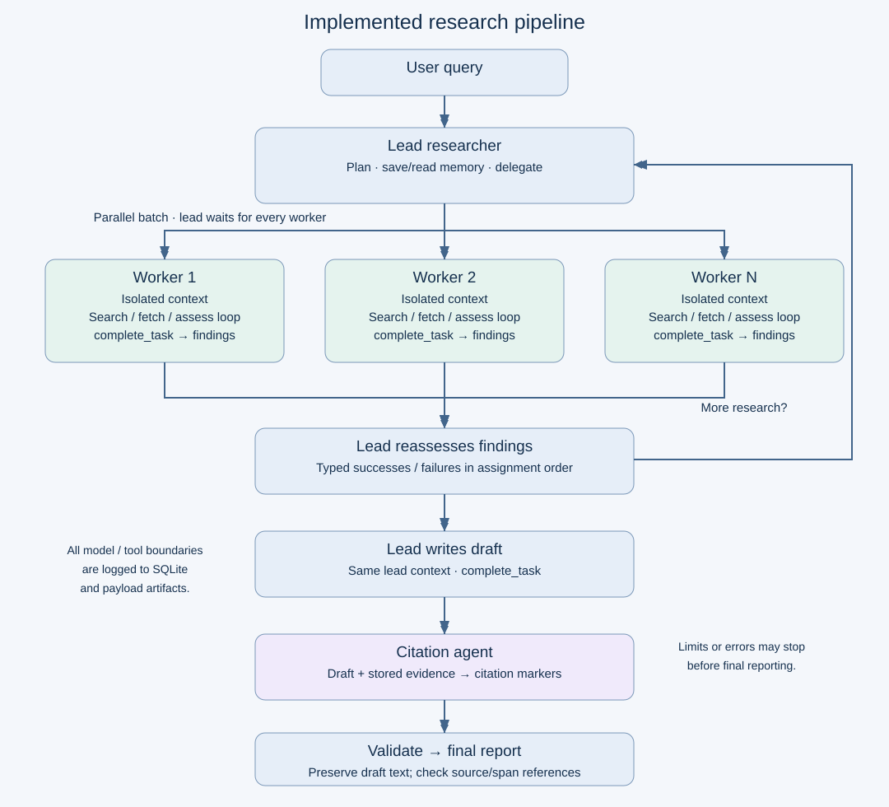

# MultiAgentResearch

A framework for studying failure propagation and recovery in multi-agent research systems. Deliverable for UCSD's CSE 291A group project, option 5.

Roles in the project should be viewed and claimed at https://docs.google.com/document/d/1XF4SLm57nb4iTCe5fPtkbTE8F_F7otnW9zPLyNgMYJU/edit?usp=sharing

## Implementation plan

1. Build a standalone Python package using LangGraph and API-based model inference, reproducing Anthropic's **publicly documented Research architecture**.
    - Use the adjacent `open_deep_research` repository as a reference, without depending on its source code.
    - The output for this step should be a baseline clean research pipeline with structured logging.
2. Build fault injection methodologies for different steps in the pipeline.
    - Following AutoInject, we intercept messages from a target agent, select each message with probability P_m, and use an LLM to rewrite a fraction P_e of its sentences into semantic errors (e.g., altered facts or numbers), which lets us vary fault frequency and severity in a controlled way.
    - Injected faults should preserve the original input/output pair separately for comparison during evaluation.

### Projected Fault Injections

  - **The lead researcher**:
      - Poison explicit plans with false premises, invalid deductions, or reversed causal relationships.
      - Change the research objective, entities, date range, scope, or acceptance criteria.
      - Omit required subtasks; create overlapping, irrelevant, or mutually inconsistent assignments.
      - Remove context, source requirements, or constraints from worker instructions.
      - Corrupt delegation tool names, arguments, output schemas, or tool permissions.
      - Misallocate worker counts and budgets; induce premature completion or repeated delegation.
      - Corrupt plan-memory updates; mark unfinished tasks complete or discard unresolved questions.
      - Alter facts, numbers, units, dates, rankings, or entity associations during synthesis.
      - Suppress conflicting findings or uncertainty; fabricate consensus or unsupported conclusions.
      - Drop findings or entire report sections despite completed worker assignments.
  - **The search subagents**:
      - Alter search terms, filters, dates, domains, or fetched URLs to investigate the wrong target.
      - Replace snippets or page text with false facts, fabricated quotations, or irrelevant content.
      - Substitute stale evidence; swap content between sources or entities.
      - Omit relevant search hits, truncate critical passages, or duplicate results to narrow coverage.
      - Insert misleading instructions into retrieved content to redirect the worker's task.
      - Corrupt calculations, comparisons, causal deductions, or aggregation of source facts.
      - Misrepresent source credibility; present speculation or conflicting evidence as established fact.
      - Fabricate findings, sources, or claims of completed searches/fetches.
      - Omit caveats, counterevidence, key findings, or provenance from the returned summary.
      - Corrupt result schemas, source IDs, or assignment IDs; return findings for the wrong task.
      - Falsely signal completion or induce repeated searches until the budget is exhausted.
  - **The citations agent**:
      - Attach a real but unrelated or contradictory source to a claim.
      - Fabricate URLs, source IDs, document titles, quotations, or supporting passages.
      - Shift citation spans or attach citations to the wrong sentence or clause.
      - Swap source-to-claim mappings or confuse versions of the same document.
      - Drop citations for substantive claims or omit sources supporting contested findings.
      - Cite search snippets as if the underlying document had been inspected.
      - Break citation markup, reference numbering, span offsets, or source resolution.
      - Rewrite, delete, or add report text during citation insertion, violating draft preservation.
  - **Pipeline faults**:
      - Inject API/tool exceptions, rate limits, connection failures, or truncated streams.
      - Delay calls or workers; trigger timeouts, cancellations, crashes, or batch stragglers.
      - Drop, duplicate, reorder, or misroute messages and tool results.
      - Deliver stale results from a previous batch, attempt, or run.
      - Corrupt serialization, required fields, tool-call IDs, or message-role metadata.
      - Lose concurrent state updates; overwrite sibling results or release the batch barrier early.
      - Deadlock batch completion by withholding a terminal worker status.
      - Lose, corrupt, or mismatch evidence files, plan-memory records, or artifact references.
      - Exceed context limits; truncate messages or evidence at critical boundaries.
      - Corrupt budget counters or termination signals; cause retry storms or repeated execution.
      - Fail checkpoint writes or load stale/incomplete checkpoints when persistence is exercised.

### Current Progress

2026/10/21 - Clean baseline implemented with LangGraph lead/worker loops. HTML viewer imimplemented in the runs directory for easy run progress/result viewing. Fault injection algorithms yet to be implemented.

### Run the baseline

```bash
uv sync --locked

# Offline two-round demonstration: no credentials, network calls, or API charges.
uv run mar --demo --config configs/baseline.yaml

# Live research: export OPENAI_API_KEY, OPENAI_BASE_URL, and TAVILY_API_KEY first.
uv run mar "What are the trade-offs of prefix caching for LLM serving?" --config configs/baseline.yaml

# Local validation.
uv run pytest -q
uv run ruff check src tests
```

Dependencies are locked in `uv.lock`. `uv sync` creates `.venv` in the repository.

Credentials are read from environment variables. `OPENAI_API_KEY`, `OPENAI_BASE_URL`, and `TAVILY_API_KEY` are required for live runs. `TAVILY_API_KEY` is used for web searches, so a free tier Tavily account is required to run this project(free tier allows 1000 searches, multiple Google accounts can be used to create additional Tavily accounts).

Inference uses `ChatOpenAI` with `use_responses_api=False` and async `ainvoke`, backed by
OpenAI SDK Chat Completions. Model names should refer to https://docs.tritonai.ucsd.edu/models. **Keep in mind that only UCSD-hosted models are available with the provided $50 API key.**

Models, budgets, and output location are configured in `configs/baseline.yaml`.
Per-role `options` accept only `temperature`, `top_p`, `seed`, `stop`, `presence_penalty`,
`frequency_penalty`, `reasoning_effort`, `logprobs`, and `top_logprobs`, subject to endpoint
support. Transport overrides and Responses API options are rejected. `max_output_tokens`
controls the output limit. For detailed information, peruse the README.md at [configs/README.md](configs/README.md).

Each run is recorded in a new `runs/YYMMDD_hhmmss_<run_id>/` directory (UTC). For easier run content viewing, a [HTML viewer](runs/index.html) is provided.

Each run directory contains:

- `run.json`: status, stop reason, worker results, aggregate usage, and checkpoint ID.
- `events.sqlite`: ordered request/result/error events, parent-event dependencies, and run records.
- `artifacts/`: content-addressed, integrity-checked payloads and retrieved source snapshots.
- `checkpoints.sqlite`: persistent lead and worker graph states, each with a distinct thread ID.
- `sources.json`: URL, title, retrieval time, extraction details, and delivered paragraphs.
- `draft.md` and `report.md`: lead draft and validated citation output, when available.

Citation markers use `[[cite:SOURCE_ID:PARAGRAPH_ID]]`, resolved through `sources.json`.
Validation preserves every draft character and checks source/span existence. It does not
judge whether claims are factually supported. Failed citation validation never publishes a
`report.md`. Logs contain research content but redact known environment credentials.

### Baseline decisions and limits

- Parallel workers run as separately checkpointed LangGraph graphs, joined with `asyncio.gather`.
  Results are delivered in assignment order, with typed failures retained alongside successes.
- Prompts are shortened, documented adaptations of pinned Cookbook references. See
  [prompt provenance](src/multi_agent_research/prompts/README.md). There is no separate writer
  or page-summary model, and no mandatory `think_tool`.
- Search uses Tavily; fetching supports public HTML/plain text with byte and text limits.
  PDF extraction, browser rendering, private integrations, and retrieval replay are not implemented.
- Independent worker tools run concurrently. Tool-call, turn, batch, and time limits are enforced.
  The run token limit is a **reported-usage stopping threshold** checked before each model call;
  an in-flight call or concurrent batch can exceed it. Per-call output limits also apply.
- All fetched source documents go to the citation pass. Exceeding its configured input character
  limit ends the run explicitly; chunked citation processing is not yet implemented.
- SDK retries are disabled. Tools return typed errors; failed workers do not erase successful
  siblings. Checkpoints support inspection, but restart/resume and recovery commands are deferred.
- Estimated model cost is `null` unless input/output rates are configured per role; search costs
  are excluded and cache-specific pricing is not modeled. Provider usage is retained in events.
- The CLI exits nonzero on failure or budget exhaustion. Scripted tests require no credentials;
  live runs are explicitly initiated by invoking the CLI without `--demo`.


### Agent workflow




```text
User query
  -> Lead researcher: plan and save plan to memory
  -> Parallel batch of independent research workers
       -> Search / fetch / assess loop
       -> Return findings, uncertainties, and source references
  -> Lead researcher: assess results and delegate another batch if needed
  -> Lead researcher: write report using its existing context
  -> Citation agent: add citations using stored source documents
  -> Deterministic citation-format validation
  -> Final report and run artifacts
```

- **Lead:** owns planning, delegation, reassessment, and final writing. Tools: plan-memory read/write, worker delegation, and task completion.
- **Workers:** use isolated contexts and bounded search/fetch loops; the lead waits for the whole batch. Workers summarize their own findings without an additional compression model.
- **Citation agent:** receives the draft and evidence, then adds source/span references while preserving the draft's wording. Validation checks references and text preservation. It does not establish factual correctness.
- **Prompts and models:** pin Anthropic's published example prompts and document adaptations. Configure model IDs, reasoning settings, and budgets independently by role.

### State, tools, and logging

- Define graph state and validated records for runs, assignments, worker results, source documents, artifacts, and usage. Merge parallel results by assignment ID.
- Provide replaceable model and search adapters, starting with one search backend and an explicit page-fetch tool. Store retrieved content and the exact extracted/truncated text delivered to agents.
- Keep immutable evidence and report artifacts on disk. Use SQLite for run/event metadata and persistent LangGraph checkpoints; expose plan memory separately from execution checkpoints.
- Log model/tool requests and responses, agent and assignment IDs, timestamps, input/output artifact dependencies, token usage, estimated cost, errors, and retry attempts. Exclude credentials from logs.
- Apply explicit concurrency, tool-call, token, and time limits. Record completion, failure, and budget exhaustion distinctly; preserve successful worker results when a sibling fails.
- Keep model/tool execution behind observable boundaries so fault injection and recovery can be added later. Do not implement those experimental policies in this milestone.

### Directory structure

```text
MultiAgentResearch/
|-- README.md
|-- pyproject.toml
|-- uv.lock
|-- .env.example                    # Credential names only
|-- docs/
|   `-- agent-graph.svg             # Pipeline diagram embedded above
|-- configs/
|   |-- README.md                   # Parameter reference
|   `-- baseline.yaml               # Models, tools, budgets, and logging settings
|-- src/multi_agent_research/
|   |-- __init__.py
|   |-- cli.py                      # Run a query and select configuration
|   |-- runner.py                   # Per-run lifecycle and output files
|   |-- viewer.py                   # Log reader / optional local server
|   |-- viewer_export.py            # Automatic standalone browser exports
|   |-- viewer.html                 # Packaged viewer UI
|   |-- vendor/markdown-it/          # Offline Markdown renderer and license
|   |-- runtime.py                  # Logged model/tool execution boundaries
|   |-- demo.py                     # Offline scripted model and tool fixtures
|   |-- config.py
|   |-- schemas.py                  # Graph state and validated data records
|   |-- graphs/
|   |   |-- research.py             # Lead loop, batch dispatch/join, finalization
|   |   |-- worker.py               # Independent research tool loop
|   |   `-- citations.py            # Citation pass and format validation
|   |-- prompts/                    # Pinned role prompts and provenance notes
|   |-- models/
|   |   `-- adapter.py              # API calls, response metadata, usage
|   |-- tools/
|   |   |-- search.py
|   |   |-- fetch.py
|   |   `-- memory.py               # Agent-accessible plan memory
|   |-- storage/
|   |   |-- artifacts.py            # Immutable source and report storage
|   |   |-- database.py             # Runs, events, and dependency metadata
|   |   `-- checkpoints.py          # Persistent LangGraph checkpoint setup
|   `-- observability/
|       |-- events.py               # Structured model/tool/agent events
|       `-- usage.py                # Token, latency, and cost accounting
|-- tests/
|   |-- unit/                       # Schemas, storage, and citation validation
|   `-- integration/                # Scripted model/tool graph tests
`-- runs/
    |-- index.html                  # Open directly in browser (tracked)
    |-- viewer-manifest.js          # Generated run list (gitignored)
    |-- viewer-assets/              # Installed offline renderer (gitignored)
    `-- YYMMDD_hhmmss_<run_id>/      # Generated logs/artifacts (gitignored; UTC)
```

<!-- ### Delivery order

1. Implement configuration, schemas, model adapter, artifact storage, and event logging.
2. Implement and test the worker graph with scripted model/search responses.
3. Add the lead graph, isolated parallel workers, and iterative batch coordination.
4. Add plan memory, citation processing, persistent checkpoints, and the CLI.
5. Validate a two-round research run with traceable sources and a cited report; then run a small live API pilot.

Acceptance checks include worker isolation, a second delegation round, bounded termination, retained sibling results after a worker error, citation text preservation, and reconstruction of the run from logs. Scripted tests should not require API credentials; live tests are explicit opt-in. -->

## References

- [AutoInject: On the Resilience of LLM-Based Multi-Agent Collaboration with Faulty Agents](https://arxiv.org/abs/2408.00989)
- [Anthropic: How we built our multi-agent research system](https://www.anthropic.com/engineering/multi-agent-research-system)
- [Anthropic Cookbook: research agent prompts](https://github.com/anthropics/claude-cookbooks/tree/main/patterns/agents/prompts)
- [LangChain Open Deep Research](https://github.com/langchain-ai/open_deep_research)
